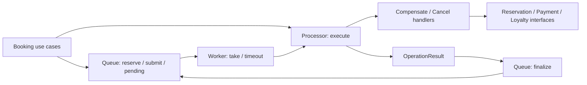

## 1. Цель

Перерефакторить исполнение операций Gateway lab3 по идее opstream из bsdn-core-v2: отдельно хранить задачи, выполнять их через обработчики и фиксировать результат, сохранив требования лабораторной и внешний HTTP-контракт.

## 2. Подход

**Согласованный объём: исполнение операций.** Пользователь выбрал этот вариант после исследования bsdn. Работать последовательно: сначала выделить текущие обязанности без изменения поведения, затем объединить компенсации и перейти к явным результатам попыток. Очередь остаётся ограниченной и в памяти; ручные конструкторы, Ent-идемпотентность Loyalty, Circuit Breaker и fallback сохраняются по [AGENTS.md](air-file://oackh4k5tgpvkqgnqnji/home/tagir/bmstu/term1M/rsoi/lab3/AGENTS.md?type=file&linesData=%7B%22range%22%3A%7B%22first%22%3A8937%2C%22second%22%3A9581%7D%2C%22lines%22%3A%7B%22first%22%3A202%2C%22second%22%3A211%7D%7D&root=%252F).

В bsdn [service.go](air-file://oackh4k5tgpvkqgnqnji/home/tagir/bsdn/bsdn-core-v2/internal/opstream/service/service.go?type=file&linesData=%7B%22range%22%3A%7B%22first%22%3A4895%2C%22second%22%3A5277%7D%2C%22lines%22%3A%7B%22first%22%3A156%2C%22second%22%3A165%7D%7D&root=%252F) координирует take/handler/finalize, [builder.go](air-file://oackh4k5tgpvkqgnqnji/home/tagir/bsdn/bsdn-core-v2/internal/opstream/service/builder.go?type=file&linesData=%7B%22range%22%3A%7B%22first%22%3A4913%2C%22second%22%3A5417%7D%2C%22lines%22%3A%7B%22first%22%3A126%2C%22second%22%3A135%7D%7D&root=%252F) выбирает обработчик, [opfinalizer.go](air-file://oackh4k5tgpvkqgnqnji/home/tagir/bsdn/bsdn-core-v2/internal/opstream/opfinalizer/opfinalizer.go?type=file&linesData=%7B%22range%22%3A%7B%22first%22%3A6637%2C%22second%22%3A7017%7D%2C%22lines%22%3A%7B%22first%22%3A201%2C%22second%22%3A209%7D%7D&root=%252F) классифицирует результат. Для двух сценариев lab3 достаточно небольшого Processor с явным выбором обработчика; generic engine, reflection и registry-builder не нужны.

### Что именно найдено в bsdn

| Механизм | Подтверждение в коде | Применение к lab3 |
|---|---|---|
| Операция имеет lifecycle Validate/Resolve/Prepare/Apply/Finish | [operation.go](air-file://oackh4k5tgpvkqgnqnji/home/tagir/bsdn/bsdn-core-v2/internal/models/opifc/operation.go?type=file&linesData=%7B%22range%22%3A%7B%22first%22%3A604%2C%22second%22%3A791%7D%2C%22lines%22%3A%7B%22first%22%3A27%2C%22second%22%3A36%7D%7D&root=%252F), [operation_group.go](air-file://oackh4k5tgpvkqgnqnji/home/tagir/bsdn/bsdn-core-v2/internal/core/usecases/operation_group.go?type=file&linesData=%7B%22range%22%3A%7B%22first%22%3A6900%2C%22second%22%3A7229%7D%2C%22lines%22%3A%7B%22first%22%3A154%2C%22second%22%3A163%7D%7D&root=%252F) | Команда хранит данные/невыполненные шаги; исполнитель проверяет и применяет их; очередь фиксирует результат |
| Отдельный taker захватывает операцию | [reader.go](air-file://oackh4k5tgpvkqgnqnji/home/tagir/bsdn/bsdn-core-v2/internal/opstream/optaker/reader.go?type=file&linesData=%7B%22range%22%3A%7B%22first%22%3A2454%2C%22second%22%3A3021%7D%2C%22lines%22%3A%7B%22first%22%3A77%2C%22second%22%3A86%7D%7D&root=%252F) | Атомарный захват задачи в памяти без mutex на время HTTP |
| Stream не реализует бизнес-шаги | [service.go](air-file://oackh4k5tgpvkqgnqnji/home/tagir/bsdn/bsdn-core-v2/internal/opstream/service/service.go?type=file&linesData=%7B%22range%22%3A%7B%22first%22%3A4895%2C%22second%22%3A5277%7D%2C%22lines%22%3A%7B%22first%22%3A156%2C%22second%22%3A165%7D%7D&root=%252F) | Worker управляет временем/контекстом, Processor управляет шагами |
| Финализация выполняется отдельно | [op_context.go](air-file://oackh4k5tgpvkqgnqnji/home/tagir/bsdn/bsdn-core-v2/internal/opstream/opfinalizer/op_context.go?type=file&linesData=%7B%22range%22%3A%7B%22first%22%3A457%2C%22second%22%3A753%7D%2C%22lines%22%3A%7B%22first%22%3A25%2C%22second%22%3A34%7D%7D&root=%252F), [opfinalizer.go](air-file://oackh4k5tgpvkqgnqnji/home/tagir/bsdn/bsdn-core-v2/internal/opstream/opfinalizer/opfinalizer.go?type=file&linesData=%7B%22range%22%3A%7B%22first%22%3A6637%2C%22second%22%3A7017%7D%2C%22lines%22%3A%7B%22first%22%3A201%2C%22second%22%3A209%7D%7D&root=%252F) | Результат содержит остаток работы и причину; finalization обновляет или удаляет запись |
| Сборка handlers/middleware отделена | [manager.go](air-file://oackh4k5tgpvkqgnqnji/home/tagir/bsdn/bsdn-core-v2/internal/opstream/manager.go?type=file&linesData=%7B%22range%22%3A%7B%22first%22%3A5006%2C%22second%22%3A5811%7D%2C%22lines%22%3A%7B%22first%22%3A166%2C%22second%22%3A174%7D%7D&root=%252F) | Сборка через cmd и конструкторы; существующее логирование/autometrics |
| Задачи и статусы хранятся в PostgreSQL | [reader.go](air-file://oackh4k5tgpvkqgnqnji/home/tagir/bsdn/bsdn-core-v2/internal/opstream/optaker/reader.go?type=file&linesData=%7B%22range%22%3A%7B%22first%22%3A2454%2C%22second%22%3A3021%7D%2C%22lines%22%3A%7B%22first%22%3A77%2C%22second%22%3A86%7D%7D&root=%252F) | Переносится разделение ролей; хранение остаётся в памяти по AGENTS |

Savepoint rollback в [op_context.go](air-file://oackh4k5tgpvkqgnqnji/home/tagir/bsdn/bsdn-core-v2/internal/opstream/opfinalizer/op_context.go?type=file&linesData=%7B%22range%22%3A%7B%22first%22%3A457%2C%22second%22%3A753%7D%2C%22lines%22%3A%7B%22first%22%3A25%2C%22second%22%3A34%7D%7D&root=%252F) откатывает локальную БД. Он не отменяет HTTP-действия Payment/Reservation: lab3 по-прежнему использует явные компенсирующие операции.

### Текущее место рефакторинга

[queue.go](air-file://oackh4k5tgpvkqgnqnji/home/tagir/bmstu/term1M/rsoi/lab3/services/gateway/internal/core/services/retries/queue.go?type=file&linesData=%7B%22range%22%3A%7B%22first%22%3A816%2C%22second%22%3A1029%7D%2C%22lines%22%3A%7B%22first%22%3A34%2C%22second%22%3A43%7D%7D&root=%252F) совмещает map/mutex, резервирование, HTTP-вызовы, таймер и фоновые попытки. [rollback.go](air-file://oackh4k5tgpvkqgnqnji/home/tagir/bmstu/term1M/rsoi/lab3/services/gateway/internal/core/usecases/bookings/rollback.go?type=file&linesData=%7B%22range%22%3A%7B%22first%22%3A119%2C%22second%22%3A526%7D%2C%22lines%22%3A%7B%22first%22%3A10%2C%22second%22%3A19%7D%7D&root=%252F) отдельно реализует ту же компенсацию. Синхронный откат идёт Reservation → Payment, фоновый Attempt — Payment → Reservation; эту разницу учесть до объединения. [cancel.go](air-file://oackh4k5tgpvkqgnqnji/home/tagir/bmstu/term1M/rsoi/lab3/services/gateway/internal/core/usecases/bookings/cancel.go?type=file&linesData=%7B%22range%22%3A%7B%22first%22%3A192%2C%22second%22%3A628%7D%2C%22lines%22%3A%7B%22first%22%3A12%2C%22second%22%3A21%7D%7D&root=%252F) содержит ещё один порядок исполнения Payment → Reservation → Loyalty.

Предлагаемый граф:



Создание оплаты и бронирования остаётся синхронным use case; общий исполнитель обслуживает его компенсацию и завершение отмены. POST Payment не включается в повторяемую задачу.

## 3. Изменения файлов

В таблице ссылки содержат точные существующие пути и позиции. Все изменения ограничены lab3; bsdn служит исследованным образцом.

| Действие | Файл | Изменение |
|---|---|---|
| Modify | [retry.go](air-file://oackh4k5tgpvkqgnqnji/home/tagir/bmstu/term1M/rsoi/lab3/services/gateway/internal/models/entities/retry.go?type=file&linesData=%7B%22range%22%3A%7B%22first%22%3A122%2C%22second%22%3A351%7D%2C%22lines%22%3A%7B%22first%22%3A5%2C%22second%22%3A14%7D%7D&root=%252F) | Добавить вид операции (компенсация создания / завершение отмены) и результат попытки; сохранить данные UUID, пользователя, ключа и невыполненных шагов. |
| Modify | [queue.go](air-file://oackh4k5tgpvkqgnqnji/home/tagir/bmstu/term1M/rsoi/lab3/services/gateway/internal/models/retryifc/queue.go?type=file&linesData=%7B%22range%22%3A%7B%22first%22%3A66%2C%22second%22%3A202%7D%2C%22lines%22%3A%7B%22first%22%3A4%2C%22second%22%3A9%7D%7D&root=%252F) | Отделить контракт производителя задач от выполнения. Сохранить Reserve/Submit/Release/Pending на первом этапе; затем определить явное владение принятым заданием и фиксацию результата. |
| Modify | [queue.go](air-file://oackh4k5tgpvkqgnqnji/home/tagir/bmstu/term1M/rsoi/lab3/services/gateway/internal/core/services/retries/queue.go?type=file&linesData=%7B%22range%22%3A%7B%22first%22%3A816%2C%22second%22%3A1029%7D%2C%22lines%22%3A%7B%22first%22%3A34%2C%22second%22%3A43%7D%7D&root=%252F) | Оставить ограниченное хранение, резервирование, дедупликацию, выбор задач и фиксацию результата. Убрать downstream-поля, Attempt и цикл Run после переноса. |
| Modify | [queue_test.go](air-file://oackh4k5tgpvkqgnqnji/home/tagir/bmstu/term1M/rsoi/lab3/services/gateway/internal/core/services/retries/queue_test.go?type=file&linesData=%7B%22range%22%3A%7B%22first%22%3A1693%2C%22second%22%3A2175%7D%2C%22lines%22%3A%7B%22first%22%3A68%2C%22second%22%3A77%7D%7D&root=%252F) | Оставить проверки хранилища и capacity; проверки HTTP-шагов перенести к исполнителю, таймеров/остановки — к worker. Добавить тест устаревшего результата. |
| Modify | [service.go](air-file://oackh4k5tgpvkqgnqnji/home/tagir/bmstu/term1M/rsoi/lab3/services/gateway/internal/core/usecases/bookings/service.go?type=file&linesData=%7B%22range%22%3A%7B%22first%22%3A316%2C%22second%22%3A568%7D%2C%22lines%22%3A%7B%22first%22%3A17%2C%22second%22%3A25%7D%7D&root=%252F) | Передать исполнитель операций через конструктор отдельно от очереди; сохранить striped locks отмены и параметры существующего use case. |
| Modify | [create.go](air-file://oackh4k5tgpvkqgnqnji/home/tagir/bmstu/term1M/rsoi/lab3/services/gateway/internal/core/usecases/bookings/create.go?type=file&linesData=%7B%22range%22%3A%7B%22first%22%3A638%2C%22second%22%3A900%7D%2C%22lines%22%3A%7B%22first%22%3A29%2C%22second%22%3A38%7D%7D&root=%252F) | Создавать описанную данными операцию компенсации после отказа; вызывать общий исполнитель и фиксировать остаток в очереди. |
| Modify | [cancel.go](air-file://oackh4k5tgpvkqgnqnji/home/tagir/bmstu/term1M/rsoi/lab3/services/gateway/internal/core/usecases/bookings/cancel.go?type=file&linesData=%7B%22range%22%3A%7B%22first%22%3A192%2C%22second%22%3A628%7D%2C%22lines%22%3A%7B%22first%22%3A12%2C%22second%22%3A21%7D%7D&root=%252F) | Передавать шаги отмены общему исполнителю; оставить проверку владельца, резервирование и HTTP-решение по результату в use case. |
| Modify | [test_service_test.go](air-file://oackh4k5tgpvkqgnqnji/home/tagir/bmstu/term1M/rsoi/lab3/services/gateway/internal/core/usecases/bookings/test_service_test.go?type=file&linesData=%7B%22range%22%3A%7B%22first%22%3A219%2C%22second%22%3A567%7D%2C%22lines%22%3A%7B%22first%22%3A11%2C%22second%22%3A17%7D%7D&root=%252F) | Собрать Queue и Processor вручную для unit-тестов, как в cmd. |
| Modify | [create_test.go](air-file://oackh4k5tgpvkqgnqnji/home/tagir/bmstu/term1M/rsoi/lab3/services/gateway/internal/core/usecases/bookings/create_test.go?type=file&linesData=%7B%22range%22%3A%7B%22first%22%3A190%2C%22second%22%3A593%7D%2C%22lines%22%3A%7B%22first%22%3A17%2C%22second%22%3A26%7D%7D&root=%252F) | Сохранить контракт создания/отката и обновить ожидания общей реализации. |
| Modify | [cancel_test.go](air-file://oackh4k5tgpvkqgnqnji/home/tagir/bmstu/term1M/rsoi/lab3/services/gateway/internal/core/usecases/bookings/cancel_test.go?type=file&linesData=%7B%22range%22%3A%7B%22first%22%3A179%2C%22second%22%3A601%7D%2C%22lines%22%3A%7B%22first%22%3A15%2C%22second%22%3A24%7D%7D&root=%252F) | Проверить первичный отказ Payment, отказ Reservation, deferred Loyalty, повторный/конкурентный DELETE и заполненную очередь. |
| Modify | [fault_tolerance_test.go](air-file://oackh4k5tgpvkqgnqnji/home/tagir/bmstu/term1M/rsoi/lab3/services/gateway/internal/core/usecases/bookings/fault_tolerance_test.go?type=file&linesData=%7B%22range%22%3A%7B%22first%22%3A1367%2C%22second%22%3A1951%7D%2C%22lines%22%3A%7B%22first%22%3A41%2C%22second%22%3A50%7D%7D&root=%252F) | Проверить единый путь компенсации и сохранение первоначальной ошибки, в том числе при отмене входящего контекста. |
| Modify | [config.go](air-file://oackh4k5tgpvkqgnqnji/home/tagir/bmstu/term1M/rsoi/lab3/services/gateway/cmd/gateway/config.go?type=file&linesData=%7B%22range%22%3A%7B%22first%22%3A233%2C%22second%22%3A851%7D%2C%22lines%22%3A%7B%22first%22%3A14%2C%22second%22%3A23%7D%7D&root=%252F) | Сохранить внешние YAML-ключи retries; при выделении Config перенаправить тип на новый файл того же пакета. |
| Modify | [run.go](air-file://oackh4k5tgpvkqgnqnji/home/tagir/bmstu/term1M/rsoi/lab3/services/gateway/cmd/gateway/run.go?type=file&linesData=%7B%22range%22%3A%7B%22first%22%3A1665%2C%22second%22%3A2271%7D%2C%22lines%22%3A%7B%22first%22%3A56%2C%22second%22%3A65%7D%7D&root=%252F) | Собрать Queue → Processor → Worker через конструкторы, передать Processor в bookings и обеспечить join worker до закрытия HTTP-клиента/логов. |
| Modify | [failures_test.go](air-file://oackh4k5tgpvkqgnqnji/home/tagir/bmstu/term1M/rsoi/lab3/services/gateway/tests/e2e/bookings/failures_test.go?type=file&linesData=%7B%22range%22%3A%7B%22first%22%3A2467%2C%22second%22%3A3072%7D%2C%22lines%22%3A%7B%22first%22%3A68%2C%22second%22%3A77%7D%7D&root=%252F) | Сохранить действующие сценарии остановки сервисов; добавить прохождение синхронной компенсации и её фонового продолжения через один Processor. |
| Modify | [README.md](air-file://oackh4k5tgpvkqgnqnji/home/tagir/bmstu/term1M/rsoi/lab3/README.md?type=file&linesData=%7B%22range%22%3A%7B%22first%22%3A0%2C%22second%22%3A339%7D%2C%22lines%22%3A%7B%22first%22%3A0%2C%22second%22%3A9%7D%7D&root=%252F) | Описать разделение ответственности и прежние ограничения очереди. |
| Modify | [services.md](air-file://oackh4k5tgpvkqgnqnji/home/tagir/bmstu/term1M/rsoi/lab3/docs/services.md?type=file&linesData=%7B%22range%22%3A%7B%22first%22%3A0%2C%22second%22%3A433%7D%2C%22lines%22%3A%7B%22first%22%3A0%2C%22second%22%3A8%7D%7D&root=%252F) | Обновить схему исполнения операций и команды проверки. |
| Delete, после переноса всех вызовов | [rollback.go](air-file://oackh4k5tgpvkqgnqnji/home/tagir/bmstu/term1M/rsoi/lab3/services/gateway/internal/core/usecases/bookings/rollback.go?type=file&linesData=%7B%22range%22%3A%7B%22first%22%3A119%2C%22second%22%3A526%7D%2C%22lines%22%3A%7B%22first%22%3A10%2C%22second%22%3A19%7D%7D&root=%252F) | Удалить дублирующий исполнитель; bounded detached context оставить в use case или его небольшом локальном методе |

**Create — ещё не существующие файлы, точные пути относительно корня lab3:**

- `services/gateway/internal/models/operationifc/executor.go` — Executor с Execute(ctx, Retry) OperationResult; интерфейс использует только сущности и стандартную библиотеку.
- `services/gateway/internal/models/entities/retry_test.go` — Проверки вида операции, допустимых payload/шагов и результата, не сериализации HTTP.
- `services/gateway/internal/core/usecases/operations/processor.go` — Небольшой Processor: проверка команды и явный выбор двух обработчиков; зависимости передаются через конструктор.
- `services/gateway/internal/core/usecases/operations/compensate.go` — Единое исполнение независимых шагов компенсации создания.
- `services/gateway/internal/core/usecases/operations/cancel.go` — Последовательные шаги завершения отмены Payment → Reservation → Loyalty.
- `services/gateway/internal/core/usecases/operations/processor_test.go` — Тесты отказов каждого шага, повторов, стабильного ключа и сохранения результата.
- `services/gateway/internal/core/services/retries/config.go` — Существующий Config и Validate без изменения mapstructure и значений.
- `services/gateway/internal/core/services/retries/worker.go` — Только цикл take → execute → finalize, timeout, интервал и контекст приложения.
- `services/gateway/internal/core/services/retries/worker_test.go` — synctest проверки 10s/5s, остановки, принадлежности результата и освобождения ёмкости.

Новых зависимостей и миграций не требуется. Существующий [loyalties.go](air-file://oackh4k5tgpvkqgnqnji/home/tagir/bmstu/term1M/rsoi/lab3/services/loyalty/internal/postgres/repos/loyalties.go?type=file&linesData=%7B%22range%22%3A%7B%22first%22%3A2032%2C%22second%22%3A2615%7D%2C%22lines%22%3A%7B%22first%22%3A70%2C%22second%22%3A79%7D%7D&root=%252F) уже сохраняет ключ и изменение счётчика в транзакции. Внешние YAML-имена и значения, HTTP/OpenAPI и Postman assertions не меняются.

## 4. Шаги реализации

### Этап 0: Зафиксировать поведение

1. Сверить текущее состояние Git: в рабочем дереве много staged новых файлов предыдущей реализации. Не сбрасывать их; получить согласованную исходную точку для последующих проверяемых изменений.
2. На [queue_test.go](air-file://oackh4k5tgpvkqgnqnji/home/tagir/bmstu/term1M/rsoi/lab3/services/gateway/internal/core/services/retries/queue_test.go?type=file&linesData=%7B%22range%22%3A%7B%22first%22%3A1693%2C%22second%22%3A2175%7D%2C%22lines%22%3A%7B%22first%22%3A68%2C%22second%22%3A77%7D%7D&root=%252F), [create_test.go](air-file://oackh4k5tgpvkqgnqnji/home/tagir/bmstu/term1M/rsoi/lab3/services/gateway/internal/core/usecases/bookings/create_test.go?type=file&linesData=%7B%22range%22%3A%7B%22first%22%3A190%2C%22second%22%3A593%7D%2C%22lines%22%3A%7B%22first%22%3A17%2C%22second%22%3A26%7D%7D&root=%252F) и [cancel_test.go](air-file://oackh4k5tgpvkqgnqnji/home/tagir/bmstu/term1M/rsoi/lab3/services/gateway/internal/core/usecases/bookings/cancel_test.go?type=file&linesData=%7B%22range%22%3A%7B%22first%22%3A179%2C%22second%22%3A601%7D%2C%22lines%22%3A%7B%22first%22%3A15%2C%22second%22%3A24%7D%7D&root=%252F) зафиксировать матрицу: успех; каждый отказ; первоначальная ошибка; остаток шагов; stable key; освобождение capacity.
3. В [fault_tolerance_test.go](air-file://oackh4k5tgpvkqgnqnji/home/tagir/bmstu/term1M/rsoi/lab3/services/gateway/internal/core/usecases/bookings/fault_tolerance_test.go?type=file&linesData=%7B%22range%22%3A%7B%22first%22%3A1367%2C%22second%22%3A1951%7D%2C%22lines%22%3A%7B%22first%22%3A41%2C%22second%22%3A50%7D%7D&root=%252F) добавить проверку независимых компенсаций: обе попытки выполняются при ошибке первой. Зафиксировать существующую разницу синхронного и фонового порядка без скрытой корректировки.
4. Для исполнительских символов Queue/New/Attempt/Run/Retry/rollback собрать call sites через gopls references и rg. Сейчас карта rg уже исследована: сборка в run.go и test_service_test.go, producers в create.go/cancel.go, фоновые вызовы в queue.go. gopls найден, но в read-only планировании изменения/сборка/тесты не запускались.

**Результат:** runnable baseline и конкретные тесты поведения, на которое опирается перенос.

### Этап 1: Отделить хранение от исполнения — структурное изменение

1. В [queue.go](air-file://oackh4k5tgpvkqgnqnji/home/tagir/bmstu/term1M/rsoi/lab3/services/gateway/internal/core/services/retries/queue.go?type=file&linesData=%7B%22range%22%3A%7B%22first%22%3A816%2C%22second%22%3A1029%7D%2C%22lines%22%3A%7B%22first%22%3A34%2C%22second%22%3A43%7D%7D&root=%252F) оставить map, mutex, Reserve/Submit/Release/Pending; перенести Config/Validate в новый config.go того же пакета.
2. В новый operations/processor.go извлечь текущий Attempt с неизменёнными условиями и порядком фоновых шагов. Для компилируемого промежуточного этапа operationifc.Executor сначала содержит прежний контракт Attempt(ctx, *Retry) error; к Execute(ctx, Retry) OperationResult перейти только вместе с моделью результата на этапе 2. На этом этапе временно сохранить текущую синхронную rollback-реализацию в [rollback.go](air-file://oackh4k5tgpvkqgnqnji/home/tagir/bmstu/term1M/rsoi/lab3/services/gateway/internal/core/usecases/bookings/rollback.go?type=file&linesData=%7B%22range%22%3A%7B%22first%22%3A119%2C%22second%22%3A526%7D%2C%22lines%22%3A%7B%22first%22%3A10%2C%22second%22%3A19%7D%7D&root=%252F).
3. В worker.go перенести Run/retry. Worker принимает Queue, operationifc.Executor и Config, не импортирует paymentifc/reservationifc/loyaltyifc.
4. В [run.go](air-file://oackh4k5tgpvkqgnqnji/home/tagir/bmstu/term1M/rsoi/lab3/services/gateway/cmd/gateway/run.go?type=file&linesData=%7B%22range%22%3A%7B%22first%22%3A1665%2C%22second%22%3A2271%7D%2C%22lines%22%3A%7B%22first%22%3A56%2C%22second%22%3A65%7D%7D&root=%252F) собрать репозитории, Processor, Queue и Worker вручную. Сохранить контекст приложения, отдельный timeout попытки, интервал 10s и ожидание завершения goroutine перед освобождением зависимостей.
5. В [test_service_test.go](air-file://oackh4k5tgpvkqgnqnji/home/tagir/bmstu/term1M/rsoi/lab3/services/gateway/internal/core/usecases/bookings/test_service_test.go?type=file&linesData=%7B%22range%22%3A%7B%22first%22%3A219%2C%22second%22%3A567%7D%2C%22lines%22%3A%7B%22first%22%3A11%2C%22second%22%3A17%7D%7D&root=%252F) и queue/worker тестах обновить сборку. Не менять HTTP-результаты, порядок вызовов или правила retry.

**Результат:** очередь больше не знает downstream-сервисы; существующие сценарии дают прежний результат.

### Этап 2: Операция и результат — структурное изменение

1. В [retry.go](air-file://oackh4k5tgpvkqgnqnji/home/tagir/bmstu/term1M/rsoi/lab3/services/gateway/internal/models/entities/retry.go?type=file&linesData=%7B%22range%22%3A%7B%22first%22%3A122%2C%22second%22%3A351%7D%2C%22lines%22%3A%7B%22first%22%3A5%2C%22second%22%3A14%7D%7D&root=%252F) добавить Kind с нулевым Unknown и двумя вариантами: Compensation и Cancellation. Сохранить конкретный payload, без any, JSON и функций в очереди.
2. Определить OperationResult: копия задачи с невыполненными шагами, ошибка попытки и состояние Completed/Deferred. Не добавлять новый лимит попыток или автоматическое удаление задачи при постоянной ошибке: это меняло бы действующее поведение.
3. В operations/processor.go валидировать Kind и необходимые UUID/ключи до HTTP. Явно выбрать обработчик по Kind. Известные внутренние producers создают только корректные задачи; отсутствие kind не должно случайно означать отмену.
4. Worker получает результат по значению, а не изменяемый указатель на запись очереди. В [queue.go](air-file://oackh4k5tgpvkqgnqnji/home/tagir/bmstu/term1M/rsoi/lab3/services/gateway/internal/core/services/retries/queue.go?type=file&linesData=%7B%22range%22%3A%7B%22first%22%3A816%2C%22second%22%3A1029%7D%2C%22lines%22%3A%7B%22first%22%3A34%2C%22second%22%3A43%7D%7D&root=%252F) выделить атомарные take/finalize: захват помечает запись выполняемой; возвращаемый token/поколение защищает от устаревшего результата после release/повторного reserve того же ключа.
5. Хранить ошибки в результате попытки и логировать их существующим slog с wrapping oops. Не создавать историю completed-задач или пользовательский status endpoint: завершённая запись освобождает место.
6. Мигрировать [queue.go](air-file://oackh4k5tgpvkqgnqnji/home/tagir/bmstu/term1M/rsoi/lab3/services/gateway/internal/models/retryifc/queue.go?type=file&linesData=%7B%22range%22%3A%7B%22first%22%3A66%2C%22second%22%3A202%7D%2C%22lines%22%3A%7B%22first%22%3A4%2C%22second%22%3A9%7D%7D&root=%252F) и callers через временные совместимые методы, затем удалить переходные методы после миграции всех вызовов.

**Результат:** prepare/reserve → apply/execute → finish/finalize выражены явно; неуспешный шаг остаётся повторяемым.

### Этап 3: Объединить исполнение — отдельное изменение порядка внутренних действий

1. В operations/cancel.go реализовать Cancellation строго Payment → Reservation → Loyalty. На ошибке Payment/Reservation следующий зависимый шаг не запускается. Каждая успешная стадия убирается из остатка; повтор не выполняет её вновь.
2. В operations/compensate.go реализовать независимые компенсации **Reservation → Payment** и для первичной, и для фоновой попытки. Это сохраняет нынешний синхронный порядок и меняет нынешний фоновый порядок; тестировать отдельно от механического выделения. Ошибка первого шага не блокирует второй.
3. В [create.go](air-file://oackh4k5tgpvkqgnqnji/home/tagir/bmstu/term1M/rsoi/lab3/services/gateway/internal/core/usecases/bookings/create.go?type=file&linesData=%7B%22range%22%3A%7B%22first%22%3A638%2C%22second%22%3A900%7D%2C%22lines%22%3A%7B%22first%22%3A29%2C%22second%22%3A38%7D%7D&root=%252F) создать Compensation только после известного частичного результата, выполнить её через Processor с context.WithoutCancel + rollback_timeout=5s. Сохранить исходную ошибку создания через errors.Join вместе с ошибками компенсации.
4. В [cancel.go](air-file://oackh4k5tgpvkqgnqnji/home/tagir/bmstu/term1M/rsoi/lab3/services/gateway/internal/core/usecases/bookings/cancel.go?type=file&linesData=%7B%22range%22%3A%7B%22first%22%3A192%2C%22second%22%3A628%7D%2C%22lines%22%3A%7B%22first%22%3A12%2C%22second%22%3A21%7D%7D&root=%252F) сохранить проверку владельца и striped lock. После reserve создать Cancellation и использовать Processor для первичной попытки; по результату применить прежние правила:
   - сбой первичной отмены Payment — ошибка и освобождение резерва, Reservation остаётся PAID;
   - Payment отменён, Reservation недоступен — ошибка и сохранение оставшихся шагов;
   - осталось только Loyalty из-за временной недоступности — сохранить задачу и вернуть 204;
   - остальные ошибки — сохранить прежнее отображение и незавершённую работу;
   - успех — освободить место.
5. Worker продолжает ту же команду тем же Processor. Ключ Loyalty остаётся UUID бронирования + действие, без пересоздания при retry.
6. После переноса всех callers удалить [rollback.go](air-file://oackh4k5tgpvkqgnqnji/home/tagir/bmstu/term1M/rsoi/lab3/services/gateway/internal/core/usecases/bookings/rollback.go?type=file&linesData=%7B%22range%22%3A%7B%22first%22%3A119%2C%22second%22%3A526%7D%2C%22lines%22%3A%7B%22first%22%3A10%2C%22second%22%3A19%7D%7D&root=%252F). Проверить отсутствие второго исполнителя и прямых downstream-вызовов в Queue/Worker.

**Результат:** первичная попытка и фоновое продолжение используют одну реализацию шагов; внешний контракт сохраняется.

### Этап 4: Сквозная проверка и описание

1. В [failures_test.go](air-file://oackh4k5tgpvkqgnqnji/home/tagir/bmstu/term1M/rsoi/lab3/services/gateway/tests/e2e/bookings/failures_test.go?type=file&linesData=%7B%22range%22%3A%7B%22first%22%3A2467%2C%22second%22%3A3072%7D%2C%22lines%22%3A%7B%22first%22%3A68%2C%22second%22%3A77%7D%7D&root=%252F) проверить остановку/восстановление Loyalty, Reservation и Payment, совместимость повторного DELETE и переход от синхронной компенсации к фоновой.
2. В [README.md](air-file://oackh4k5tgpvkqgnqnji/home/tagir/bmstu/term1M/rsoi/lab3/README.md?type=file&linesData=%7B%22range%22%3A%7B%22first%22%3A0%2C%22second%22%3A339%7D%2C%22lines%22%3A%7B%22first%22%3A0%2C%22second%22%3A9%7D%7D&root=%252F) и [services.md](air-file://oackh4k5tgpvkqgnqnji/home/tagir/bmstu/term1M/rsoi/lab3/docs/services.md?type=file&linesData=%7B%22range%22%3A%7B%22first%22%3A0%2C%22second%22%3A433%7D%2C%22lines%22%3A%7B%22first%22%3A0%2C%22second%22%3A8%7D%7D&root=%252F) описать границы Queue/Processor/Worker и ограничения: память 256 задач, retry 10s, timeout 5s, потеря очереди при аварии Gateway.
3. Выполнить проверки ниже. После каждого этапа оставлять работающую проверенную реализацию; структурные переносы и изменение порядка фоновой компенсации оформлять отдельными изменениями.

## 5. Критерии приёмки

1. Queue и Worker не импортируют paymentifc, reservationifc, loyaltyifc и не выполняют HTTP-вызовы; проверка импортов/rg и сборка Gateway.
2. Queue резервирует не более 256 активных задач вместе с ещё не отправленными резервами. 257-й reserve даёт прежний 503 до побочных эффектов — unit и REST-тесты.
3. Для одинакового ключа одновременно существует один владелец попытки. Устаревший token не может завершить или перезаписать новую запись — unit-тест с управляемым interleaving и -race.
4. Первичная и фоновая Compensation используют один обработчик: Reservation и Payment пытаются отмениться независимо; успешный шаг не повторяется — таблица отказов в Processor-тестах.
5. Cancellation соблюдает Payment → Reservation → Loyalty. При сбое Payment бронирование остаётся PAID; при сбое Reservation Loyalty не вызывается — Processor/unit/e2e.
6. Временный отказ Loyalty после отмены даёт 204; после восстановления счётчик уменьшается ровно на один в пределах 30s при доступных зависимостях — существующий e2e и Newman.
7. Повторный/конкурентный DELETE сохраняет stable key и не создаёт дополнительное уменьшение — cancel unit/e2e.
8. Отменённый HTTP-контекст не отменяет компенсацию; её общий timeout 5s. Worker прекращает текущую попытку при shutdown и завершает goroutine — synctest.
9. При полной успешной операции либо завершённом retry запись удаляется, ёмкость освобождается. Незавершённые шаги сохраняются для следующей попытки.
10. Existing Circuit Breaker/fallback тесты и конфигурационные проверки проходят без изменения настроек и статусов 400/404/500/503.
11. Оригинальные Newman success/step1…step4 проходят без правок assertions. У всех модулей проходят требуемые check; generated-файлы не получают непредусмотренных изменений.

## 6. Проверка

В текущей сессии выполнено чтение и сопоставление кода. Тесты и сборка **не запускались**: задача — планирование, файловая система read-only.

После реализации запускать сначала целевые тесты через существующий [Makefile](air-file://oackh4k5tgpvkqgnqnji/home/tagir/bmstu/term1M/rsoi/lab3/services/gateway/Makefile?type=file&linesData=%7B%22range%22%3A%7B%22first%22%3A400%2C%22second%22%3A823%7D%2C%22lines%22%3A%7B%22first%22%3A17%2C%22second%22%3A26%7D%7D&root=%252F) и gotestsum с -race:

```sh
make -C services/gateway unit-test
make -C services/gateway integration-test
make -C services/gateway check
make -C modules/platform check
make -C services/reservation check
make -C services/payment check
make -C services/loyalty check
make -C services/loyalty integration-test
scripts/check-generated.sh
docker compose build
GATEWAY_E2E_PREBUILT=1 make -C services/gateway e2e-test
docker compose up -d
WAIT_PORTS=8080,8070,8060,8050 scripts/wait-script.sh
scripts/prepare-classroom.sh
newman run --folder success -e v2/postman/environment.json v2/postman/collection.json
scripts/test-script.sh v2 loyalty 8050
git diff --check
```

[go.mk](air-file://oackh4k5tgpvkqgnqnji/home/tagir/bmstu/term1M/rsoi/lab3/scripts/go.mk?type=file&linesData=%7B%22range%22%3A%7B%22first%22%3A661%2C%22second%22%3A887%7D%2C%22lines%22%3A%7B%22first%22%3A16%2C%22second%22%3A25%7D%7D&root=%252F) уже запускает unit с -race. Таймеры Worker проверять testing/synctest по текущему [queue_test.go](air-file://oackh4k5tgpvkqgnqnji/home/tagir/bmstu/term1M/rsoi/lab3/services/gateway/internal/core/services/retries/queue_test.go?type=file&linesData=%7B%22range%22%3A%7B%22first%22%3A1693%2C%22second%22%3A2175%7D%2C%22lines%22%3A%7B%22first%22%3A68%2C%22second%22%3A77%7D%7D&root=%252F). Между самостоятельным success-прогоном и failover проверить ожидаемое состояние фикстур или использовать раздельные тестовые окружения; [test-script.sh](air-file://oackh4k5tgpvkqgnqnji/home/tagir/bmstu/term1M/rsoi/lab3/scripts/test-script.sh?type=file&linesData=%7B%22range%22%3A%7B%22first%22%3A623%2C%22second%22%3A1176%7D%2C%22lines%22%3A%7B%22first%22%3A25%2C%22second%22%3A34%7D%7D&root=%252F) сам запускает success и ожидает асинхронный счётчик.

Перед завершением проверить rg на дублирующую rollback-логику и старые вызовы Queue.Attempt/Queue.Run, а также направление импортов: entities/ifc → core usecases/services, конкретная сборка — только cmd.

## 7. Риски и меры

- **Изменение порядка компенсации скрывается под рефакторингом.** Разница подтверждается [rollback.go](air-file://oackh4k5tgpvkqgnqnji/home/tagir/bmstu/term1M/rsoi/lab3/services/gateway/internal/core/usecases/bookings/rollback.go?type=file&linesData=%7B%22range%22%3A%7B%22first%22%3A119%2C%22second%22%3A526%7D%2C%22lines%22%3A%7B%22first%22%3A10%2C%22second%22%3A19%7D%7D&root=%252F) и [queue.go](air-file://oackh4k5tgpvkqgnqnji/home/tagir/bmstu/term1M/rsoi/lab3/services/gateway/internal/core/services/retries/queue.go?type=file&linesData=%7B%22range%22%3A%7B%22first%22%3A816%2C%22second%22%3A1029%7D%2C%22lines%22%3A%7B%22first%22%3A34%2C%22second%22%3A43%7D%7D&root=%252F); выделить объединение и изменение фонового порядка в этап 3 с отдельными тестами.
- **Очередь освобождается раньше исполнения или результат затирает новую задачу.** В Queue хранить статус владения и поколение; take/finalize выполнять под mutex, сеть — вне него. Проверить stale-result и capacity.
- **204 при неполной критичной отмене.** Решение об ответе остаётся в [cancel.go](air-file://oackh4k5tgpvkqgnqnji/home/tagir/bmstu/term1M/rsoi/lab3/services/gateway/internal/core/usecases/bookings/cancel.go?type=file&linesData=%7B%22range%22%3A%7B%22first%22%3A192%2C%22second%22%3A628%7D%2C%22lines%22%3A%7B%22first%22%3A12%2C%22second%22%3A21%7D%7D&root=%252F); Processor возвращает точный остаток и ошибку, а не только success/failure.
- **Двойное уменьшение Loyalty после потери ответа.** Сохранить неизменный operationID и существующую транзакционную дедупликацию [loyalties.go](air-file://oackh4k5tgpvkqgnqnji/home/tagir/bmstu/term1M/rsoi/lab3/services/loyalty/internal/postgres/repos/loyalties.go?type=file&linesData=%7B%22range%22%3A%7B%22first%22%3A2032%2C%22second%22%3A2615%7D%2C%22lines%22%3A%7B%22first%22%3A70%2C%22second%22%3A79%7D%7D&root=%252F).
- **Подмена отмены HTTP-запроса отменой приложения.** Detached context допустим только для bounded синхронной компенсации; Worker использует контекст приложения из [run.go](air-file://oackh4k5tgpvkqgnqnji/home/tagir/bmstu/term1M/rsoi/lab3/services/gateway/cmd/gateway/run.go?type=file&linesData=%7B%22range%22%3A%7B%22first%22%3A1665%2C%22second%22%3A2271%7D%2C%22lines%22%3A%7B%22first%22%3A56%2C%22second%22%3A65%7D%7D&root=%252F).
- **Неопределённый исход сетевых записей и потеря in-memory очереди остаются.** Рефакторинг не даёт распределённой атомарности или сохранности при аварии Gateway; ограничения зафиксированы [AGENTS.md](air-file://oackh4k5tgpvkqgnqnji/home/tagir/bmstu/term1M/rsoi/lab3/AGENTS.md?type=file&linesData=%7B%22range%22%3A%7B%22first%22%3A8937%2C%22second%22%3A9581%7D%2C%22lines%22%3A%7B%22first%22%3A202%2C%22second%22%3A211%7D%7D&root=%252F).
- **Незакоммиченная база текущей lab3.** Сохранить staged изменения пользователя; перед реализацией выбрать стабильную исходную точку без reset/clean и без изменения bsdn.
