# Как работает Hotels Booking System

Дата сборки: 2026-10-16. PDF: [gateway-request-flow.pdf](gateway-request-flow.pdf).

Исходник и генератор: `scripts/render-gateway-guide.py`. Диаграммы в PDF векторные, текст выделяется.

## 01. Как проходит запрос

Hotels Booking System · Gateway · CQRS · Saga · Redis

- Разбор текущей реализации репозитория, а не абстрактной архитектуры. Семь внешних бизнес-ручек разобраны отдельно.
- Чтение: REST → Queries → HTTP-адаптеры → downstream → собственная БД → сборка ответа.
- Изменение: REST → Commands. Redis заранее хранит план восстановления; операции исполняются через Processor → Actions.
- R — UUID бронирования, P — UUID оплаты, H — UUID отеля. Kcreate / Kcancel — UUID задач, раздельные по виду операции. Это разные идентификаторы. Пользователь передаётся в X-User-Name.

Код: `services/gateway/cmd/gateway/run.go`, `services/gateway/internal/models/coreifc/bookings.go`.

## 02. Сначала — общий HTTP-путь

Что происходит до и после любого бизнес-сценария

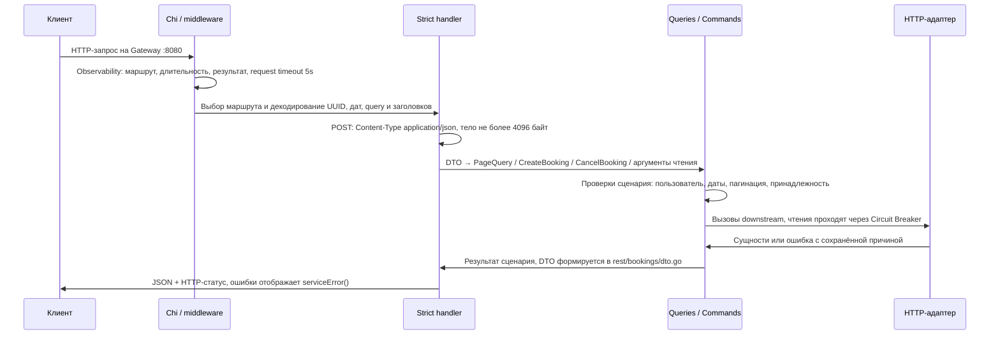

- Gateway разрешает в YAML только http.api_prefix=/api/v1. X-User-Name обязателен для пользовательских ручек; для списка отелей пользователь не нужен. Пустое имя, некорректный UTF-8 или длина > 80 символов отклоняются.
- Ошибка декодирования даёт 400 ещё до usecase. Ограничение request timeout может закончить запрос до выполнения всей цепочки.
- Queries и Commands собраны отдельно. Queries не имеет методов записи и доступа к очереди. Commands читает данные для расчёта и проверок.

Стек вызовов:

```text
cmd/gateway.Run
rest.Observability → middleware.Timeout
api.HandlerWithOptions → api.NewStrictHandlerWithOptions
handler.Get… / Post… / Delete…
BookingQueries / BookingCommands
```

Код: `services/gateway/cmd/gateway/run.go`, `services/gateway/internal/rest/bookings/register.go`, `services/gateway/internal/rest/bookings/handlers.go`.

## 03. 01 · Список отелей

GET /api/v1/hotels?page=1&size=10 · успешный ответ 200

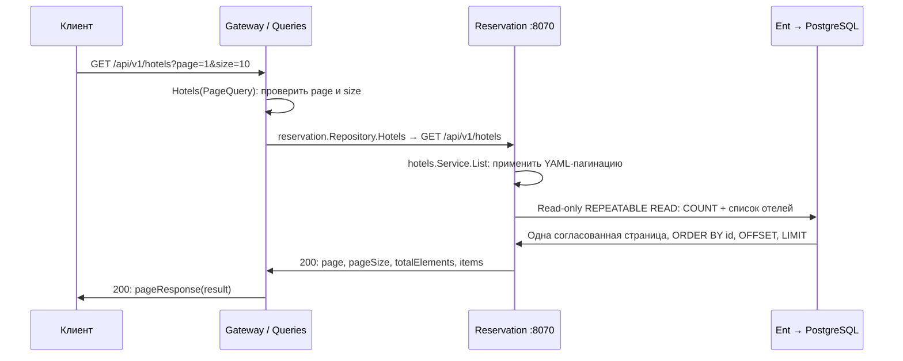

- Gateway принимает page ≥ 0; page=0 отправляет в Reservation как 1, а в ответе возвращает page=0. size в Gateway: 1..100.
- Если параметры отсутствуют, Reservation использует default_page=1 и default_size=10 из своего YAML. Лимит Reservation отдельно равен 1000.
- Отказ Reservation или открытый его breaker → 500 «Reservation Service unavailable». Payment, Loyalty и Redis не вызываются.

Стек вызовов:

```text
handler.GetApiV1Hotels
Queries.Hotels
reservation.Repository.Hotels → httpclient.Read
contracts.GetHotelsWithResponse
Reservation: hotels.Service.List → hotels.Repository.List
```

Код: `services/gateway/internal/core/usecases/bookings/read.go`, `services/gateway/internal/reservation/repos/bookings.go`, `services/reservation/internal/core/usecases/hotels/service.go`, `services/reservation/internal/postgres/repos/hotels/repository.go`.

## 04. 02 · Статус лояльности

GET /api/v1/loyalty · X-User-Name: Анна · успешный ответ 200

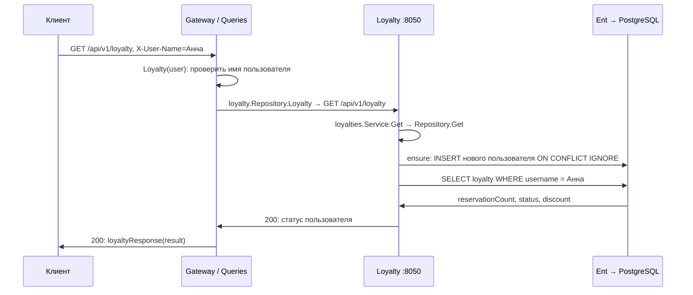

- Новый пользователь получает reservationCount=0, BRONZE, discount=5. Даже GET может создать строку Loyalty при первом обращении — это существующее поведение сервиса.
- Для этой самостоятельной ручки fallback отсутствует: отказ Loyalty → 503, message «Loyalty Service unavailable».
- Reservation, Payment и Redis не вызываются. Нулевой счётчик здорового ответа сохраняется как 0, а не исчезает.

Стек вызовов:

```text
handler.GetApiV1Loyalty
Queries.Loyalty → validateUser
loyalty.Repository.Loyalty → httpclient.Read
contracts.GetLoyaltyWithResponse
Loyalty: Service.Get → Repository.Get → ensure + SELECT
```

Код: `services/gateway/internal/core/usecases/bookings/read.go`, `services/gateway/internal/loyalty/repos/loyalty.go`, `services/loyalty/internal/postgres/repos/loyalties.go`.

## 05. 03 · Все бронирования пользователя

GET /api/v1/reservations · запрос списка и параллельное обогащение

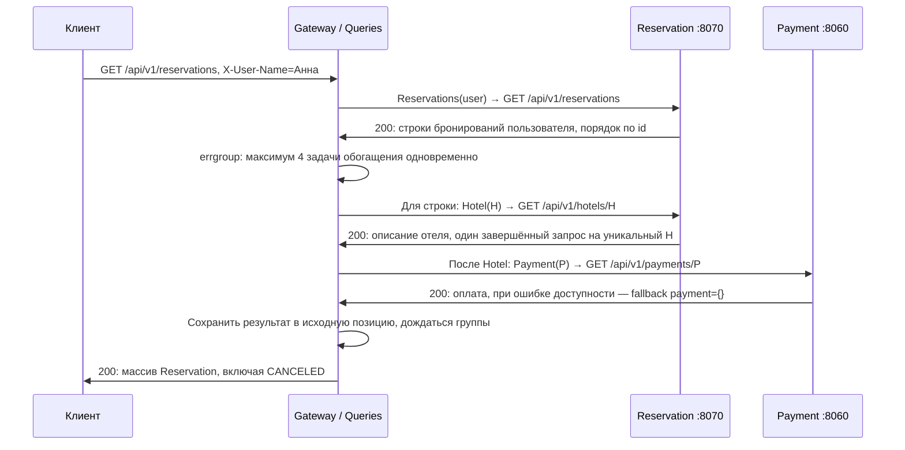

- Кэш отеля существует только внутри одного вызова List: sync.OnceValues разделяет результат и ошибку для одинакового H. Между HTTP-запросами кэша нет.
- Hotel и Payment внутри одной строки вызываются последовательно; разные строки выполняются параллельно. Дедупликации Payment нет. N строк и U уникальных отелей: до 1+U+N чтений.
- Ошибка Reservation/Hotel прерывает сборку списка; ошибка Payment доступности обнуляет только его блок. Ошибки 400/404 и отмена контекста не маскируются.

Стек вызовов:

```text
handler.GetApiV1Reservations
Queries.List → reservations.Reservations
errgroup.SetLimit(enrichment_concurrency)
reservations.Hotel → reservationWithHotel → payments.Payment
reservationResponses(items)
```

Код: `services/gateway/internal/core/usecases/bookings/list.go`, `services/gateway/internal/core/usecases/bookings/read.go`, `services/reservation/internal/postgres/repos/bookings/repository.go`.

## 06. 04 · Одно бронирование

GET /api/v1/reservations/{reservationUid} · принадлежность проверяется в Reservation

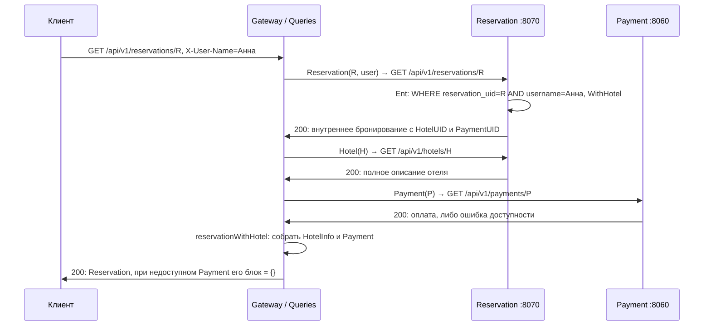

- Три последовательных downstream-чтения. Внутренний ответ Reservation содержит ссылку на отель; Gateway дополнительно получает его полное описание.
- Чужое или отсутствующее бронирование → 404. Проверка пользователя выполняется до чтения Payment. Неверный UUID пути → 400 при декодировании.
- Loyalty и Redis не участвуют. Если Reservation недоступен, частичный успешный ответ невозможен → 500.

Стек вызовов:

```text
handler.GetApiV1ReservationsReservationUid
Queries.Get → reservations.Reservation
reservations.Hotel
Queries.reservationWithHotel → payments.Payment
reservationResponse(result)
```

Код: `services/gateway/internal/core/usecases/bookings/read.go`, `services/reservation/internal/postgres/repos/bookings/repository.go`, `services/gateway/internal/rest/bookings/dto.go`.

## 07. 05 · Личный кабинет

GET /api/v1/me · сначала список, затем Loyalty

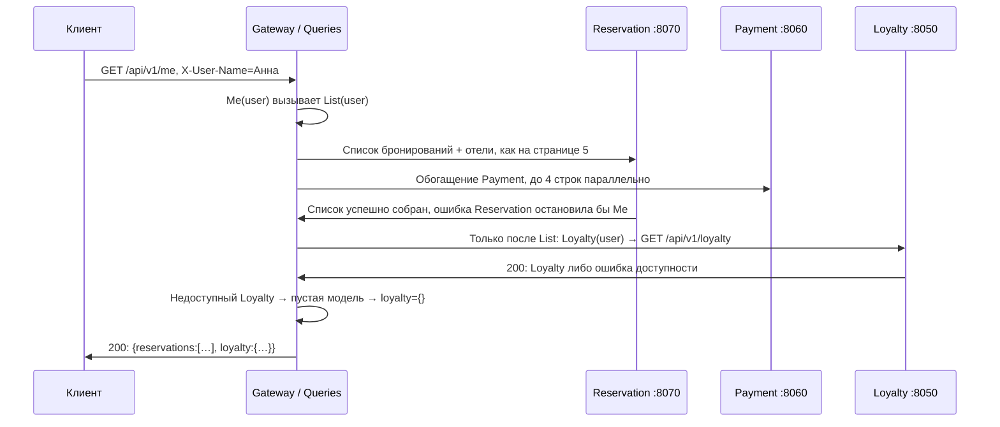

- Это последовательная композиция двух usecase-чтений: List → Loyalty. Между ними нет отдельной общей транзакции или общего снимка данных.
- Payment может отсутствовать у отдельных броней. Loyalty может отсутствовать целиком. Если оба некритичных сервиса недоступны, ответ всё ещё возможен при здоровом Reservation.
- Fallback действует только для ошибок доступности. Реальные нулевые значения здоровых моделей выводятся, 400/404 и отмена запроса не превращаются в пустой блок.

Стек вызовов:

```text
handler.GetApiV1Me
Queries.Me
Queries.List → Hotel / Payment
Queries.Loyalty
UserInfo → userInfoResponse
```

Код: `services/gateway/internal/core/usecases/bookings/read.go`, `services/gateway/internal/core/usecases/bookings/list.go`, `services/gateway/internal/rest/bookings/dto.go`.

## 08. 06 · Создание: успешный путь

POST /api/v1/reservations · синхронная Saga · внешний ответ 200

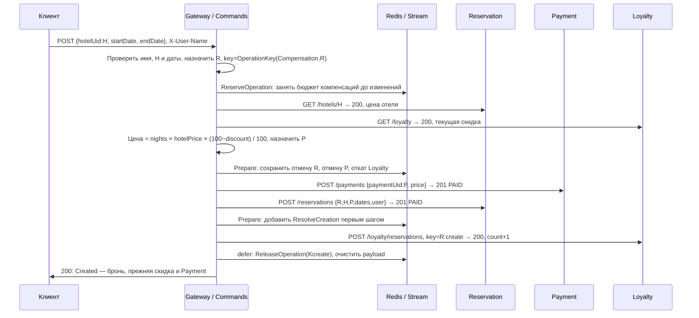

- Даты — календарные значения API. endDate должна быть позже startDate; стоимость вычисляется целочисленно, с защитой от переполнения.
- Запись оплаты и бронирования PAID появляется до увеличения Loyalty. Скидка берётся до count+1. Количество свободных номеров не ограничивается.
- Это несколько локальных транзакций разных сервисов. Ошибка Release тоже может повлиять на ответ; потерянный HTTP-ответ сам по себе не доказывает откат.

Стек вызовов:

```text
handler.PostApiV1Reservations
Commands.Create(CreateBooking)
Groups.Create → Creation.CreatePayment / CreateReservation / IncreaseLoyalty
Payment.CreatePayment → Reservation.CreateReservation
Loyalty.ChangeLoyalty(+1) → ReleaseOperation
```

Код: `services/gateway/internal/core/usecases/bookings/create.go`, `services/gateway/internal/core/usecases/operations/groups.go`, `services/gateway/internal/core/usecases/bookings/cost.go`.

## 09. Создание: если шаг не завершился

План сохранён до побочных эффектов; откат работает вне отменённого HTTP-контекста

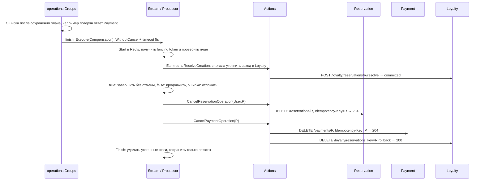

- Для ошибки до увеличения Loyalty шага ResolveCreation ещё может не быть. CancelReservation, CancelPayment и RollbackLoyalty пробуются независимо: отказ первого не отменяет попытку второго.
- Откат R:rollback уменьшает счётчик только если R:create действительно применился. Без увеличения записывается защита от позднего +1, чужие бронирования не уменьшаются.
- Groups.Create преобразует panic в ErrOperationPanic: сохранённый план проходит через finish и компенсацию вне HTTP-контекста; ответ 500. Без плана освобождается резерв. POST Payment не повторяется автоматически.

Стек вызовов:

```text
operations.Groups.Create → finish (defer)
Stream.Execute → worker.process(Initial)
Processor.compensate → operations.Actions.Execute
Actions.Execute → прямые вызовы HTTP-портов
Store.Finish: Completed / Deferred / Failed
```

Код: `services/gateway/internal/core/usecases/operations/groups.go`, `services/gateway/internal/core/usecases/operations/compensate.go`, `services/gateway/internal/core/usecases/operations/actions.go`.

## 10. 07 · Отмена: успешный путь

DELETE /api/v1/reservations/{reservationUid} · внешний ответ 204

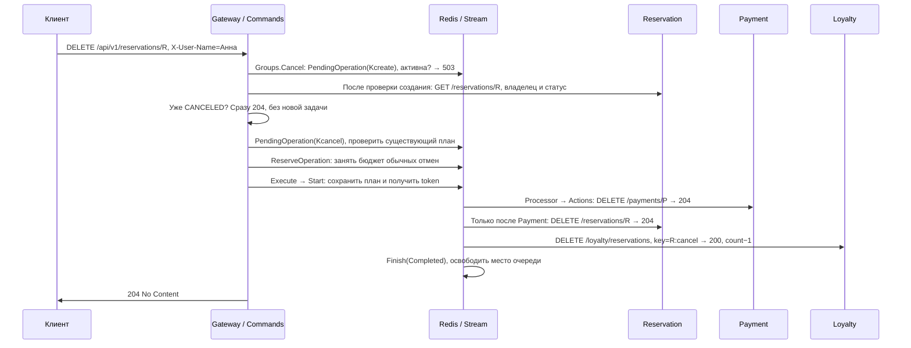

- На диаграмме Stream обозначает цепочку worker.process → Processor.cancel → Actions; HTTP выполняют downstream-адаптеры Gateway, а не Redis.
- Отмена последовательна: Payment → Reservation → Loyalty. Это другой порядок и другая политика ошибок, чем у компенсации создания.
- Активное создание/восстановление → 503 без изменений. Затем читается актуальная бронь: отмена не обгоняет +1 Loyalty. Повтор R:cancel не уменьшает счётчик дважды.

Стек вызовов:

```text
handler.DeleteApiV1ReservationsReservationUid
Commands.Cancel: validateUser → Groups.Cancel(user,R)
Groups.Cancel: pending(Kcreate) → Reservation → pending(Kcancel)
Groups.execute → reserve → Stream.Execute → Processor.cancel
Payment → Reservation → Loyalty → Store.Finish
```

Код: `services/gateway/internal/core/usecases/bookings/cancel.go`, `services/gateway/internal/core/usecases/operations/cancel.go`.

## 11. Отмена: все важные развилки

Почему одинаковый DELETE может вернуть 204, 400, 404, 500, 502, 503 или 504

| Ситуация | Данные / очередь | Внешний результат |
| --- | --- | --- |
| Неверный ввод / чужая или отсутствующая бронь | Изменений нет | 400 / 404 |
| Reservation недоступен при чтении | Изменений нет | 500 |
| Redis недоступен / очередь заполнена | Бизнес-изменения ещё не начаты | 503 |
| Первичный отказ отмены Payment | Reservation PAID; слот освобождается | Ошибка, обычно 502 / 504 |
| Payment отменён, Reservation не отменён | Остаток плана повторяется | Ошибка, обычно 500 |
| P и R отменены, Loyalty недоступен | Остаётся DecreaseLoyalty; очередь принята | 204 |
| Все шаги выполнены / R уже CANCELED | Повторного уменьшения нет | 204 |

- Повторный DELETE сначала читает Reservation. Если статус уже CANCELED, возвращает 204; ранее поставленная задача Loyalty продолжает выполняться независимо.
- Если текущая задача ещё содержит CancelPayment или CancelReservation, повтор получает ошибку Reservation unavailable. Если остался только Loyalty, запрос принимается без повторного списания.
- 204 после отказа Loyalty означает принятую отложенную работу, а не уже изменённый счётчик. Для критичных шагов успешный ответ не подделывается.

Стек вызовов:

```text
Groups.Cancel → entities.HasAction[T](result.Task)
Processor.Execute: Initial vs Background
Initial + Payment не отменён → Rejected
Deferred → план остаётся в Redis
serviceError → внешний статус
```

Код: `services/gateway/internal/core/usecases/bookings/cancel.go`, `services/gateway/internal/core/usecases/operations/processor.go`, `services/gateway/internal/rest/bookings/errors.go`.

## 12. Как исполняется операция

У очереди свой UUID-ключ; бизнес-данные находятся в конкретных Go DTO

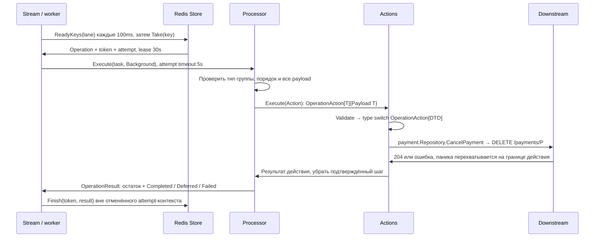

- Operation = {Kind, Key, Steps}. OperationAction[T] = {Payload T}; действие задаёт Go-тип DTO; Steps — []Action. Key — UUID задачи. DTO — Go-значение; только Redis-адаптер кодирует его в Gob. Конверт и действия не содержат версий.
- Каждому действию соответствует свой DTO: CancelPayment, CancelReservation, ResolveCreation, RollbackLoyalty, DecreaseLoyalty. Processor зависит от интерфейса ActionExecutor; реализации связывает cmd/gateway.
- Успешные действия не возвращаются в план. Повтор возможен, если действие выполнено, а Finish потерян; downstream защищает бизнес-эффект идемпотентностью.

Стек вызовов:

```text
worker.runLane → runReady → execute
Store.Take → worker.process
Processor.Execute → cancel / compensate
operations.Actions.Execute: type switch по Go-типу
operations.Actions → HTTP repo → Store.Finish
```

Код: `services/gateway/internal/core/services/opstream/worker.go`, `services/gateway/internal/core/usecases/operations/actions.go`, `services/gateway/internal/models/entities/operation_payload.go`.

## 13. Redis: состояния и планирование

Redis Streams выдаёт задачи; Go координирует записи через WATCH + MULTI/EXEC

- Общий бюджет — 256 активных задач: 128 компенсаций и 128 отмен. Failed для ручного повтора удерживает место; Rejected освобождает слот. В обоих случаях Redis state=failed; различается удержание задачи.
- Компенсации обслуживают 2 worker, отмены — 1, остаток только Loyalty — ещё 1. Общий параметр concurrency=4. Остаток отмены переводится в отдельную lane Loyalty.
- Redis AOF с appendfsync always и отдельным volume сохраняет очередь. В PostgreSQL хранятся бизнес-данные и записи идемпотентности, а не эмуляция очереди.

Стек вызовов:

```text
Reserve → reserved (запись может ещё не иметь payload)
Prepare → сохранить план до первого POST
Start / Take → running с lease и token
Deferred → следующий срок через 10s
Failed → inspect-operation / retry-operation
```

Код: `services/gateway/internal/redis/repos/transaction.go`, `services/gateway/internal/redis/repos/streams.go`, `redis/redis.conf`, `services/gateway/config.yaml`.

## 14. Redis Streams: публикация и выдача

Sorted sets задают задержку; consumer group workers отслеживает доставку

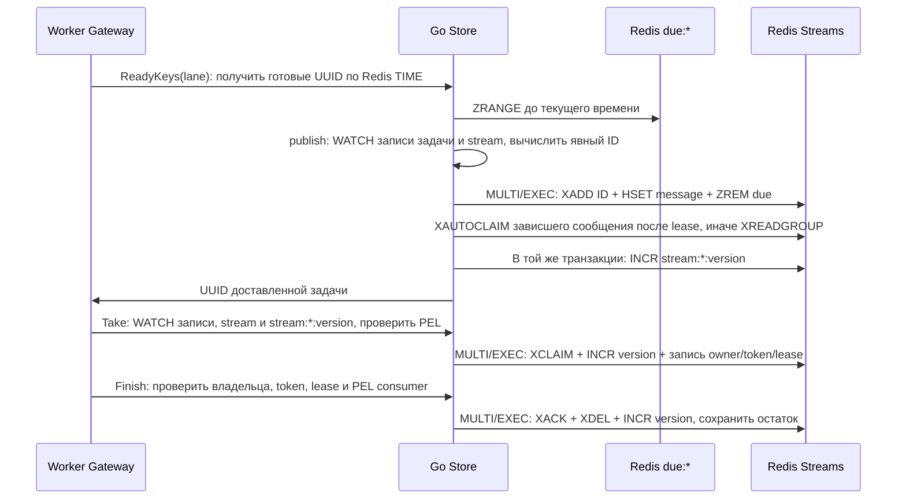

- Изменения Pending Entries List (PEL) сами не инвалидируют WATCH. Поэтому XREADGROUP, XAUTOCLAIM, XCLAIM и подтверждение увеличивают stream:*:version в той же транзакции; Take и Finish наблюдают за этой версией.
- Явный возрастающий ID позволяет атомарно записать сообщение и ссылку message в hash задачи. Finish при Deferred подтверждает старое сообщение и назначает новый срок в due:*.
- Store.update повторяет только redis.TxFailedErr, в пределах storage_timeout. Сетевые ошибки не повторяются автоматически: исход EXEC может быть неизвестен. Lua и EVAL не используются.

Стек вызовов:

```text
ReadyKeys → publish → XAUTOCLAIM / XREADGROUP
Take → deliveryOwned → XCLAIM + HSET
Finish → acknowledge → schedule / remove
```

Код: `services/gateway/internal/redis/repos/streams.go`, `services/gateway/internal/redis/repos/transaction.go`, `services/gateway/internal/redis/repos/attempts.go`.

## 15. Падение Gateway: lease и fencing

Новый экземпляр подхватывает сохранённую задачу; старый не может перезаписать её результат

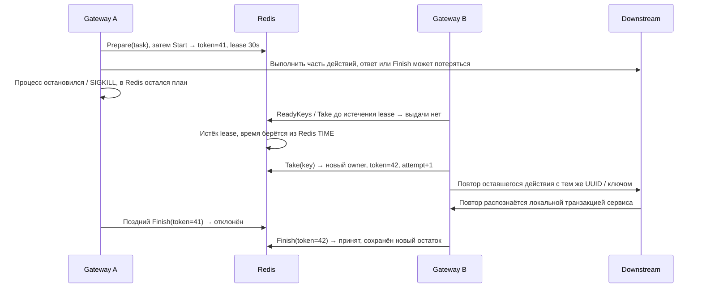

- Fencing защищает фиксацию очереди, но не отменяет уже отправленный HTTP-запрос старого worker. Повторный бизнес-эффект ограничивают ключи и транзакции downstream.
- Если процесс умер после Reserve, но до Prepare, задача без payload после истечения lease освобождается: побочные эффекты ещё не должны были начаться.
- Гарантии общей распределённой атомарности нет. Клиент также может не знать итог при потерянном ответе, даже если данные уже зафиксированы.

Стек вызовов:

```text
Store.update: WATCH записи → проверки → MULTI/EXEC
Take: проверить PEL consumer, назначить token и attempt+1
Finish: owner + lease + token + state=running
Payment/Reservation guards + Loyalty operation key
Gateway при shutdown останавливает worker и вызывает Drain
```

Код: `services/gateway/internal/redis/repos/attempts.go`, `services/gateway/internal/core/services/opstream/worker.go`, `services/gateway/cmd/gateway/run.go`.

## 16. Неоднозначный исход создания

Что делать, если увеличение Loyalty закоммитилось, а ответ потерян

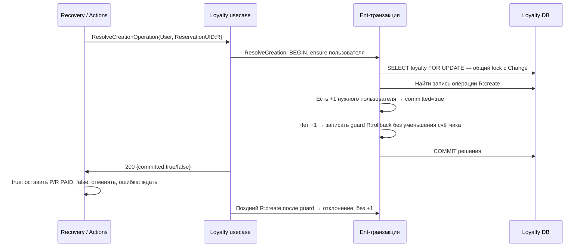

- ResolveCreation — изменяющий POST: он может записать запрет позднего создания. Он не защищается read-breaker и не является простым GET состояния.
- Общий lock пользователя сериализует гонку ResolveCreation и Change(+1). Решение определяется зафиксированной записью R:create, а не предположением по таймауту HTTP.
- Если Loyalty недоступен, компенсация с ResolveCreation не отменяет Payment и Reservation вслепую: весь план ждёт следующей попытки.

Стек вызовов:

```text
Actions.Execute: ResolveCreationOperation
loyalty.Repository.ResolveCreation (HTTP)
Loyalty Service.ResolveCreation
postgres.Repository.ResolveCreation
CreationResolution.Decide под row lock
```

Код: `services/gateway/internal/core/usecases/operations/compensate.go`, `services/loyalty/internal/postgres/repos/loyalties.go`, `services/loyalty/internal/models/entities/change.go`.

## 17. Внутренние ручки Reservation

Эти ручки вызывает Gateway; префикс /api/v1; сервис работает со своей логической БД

| Метод / путь | Стек внутри Reservation | Работа с собственной БД |
| --- | --- | --- |
| GET /hotels | rest/hotels → Service.List → Repository.List | REPEATABLE READ: COUNT + ORDER BY id / OFFSET / LIMIT |
| GET /hotels/{hotelUid} | rest/hotels → Service.Get → Repository.Get | Поиск hotels по hotel_uid; отсутствие → 404 |
| GET /reservations | rest/bookings → Service.List → Repository.List | username=user; WithHotel; ORDER BY id |
| GET /reservations/{reservationUid} | rest/bookings → Service.Get → Repository.Get | reservation_uid + username; чужая бронь → 404 |
| POST /reservations | rest/bookings → Service.Create → Repository.Create | Транзакция guard + сверка повтора + отель + INSERT PAID; 201 |
| DELETE /reservations/{reservationUid} | rest/bookings → Service.CancelKnown / Cancel | guard canceled + UPDATE CANCELED; 204 |

- Create: claim BookingRequest(R,user), FOR UPDATE, проверить canceled/user, найти существующую бронь. Совпадающий повтор возвращает её; другой payload или статус → 400.
- Новая бронь: найти отель в той же логической БД, создать reservation PAID со ссылкой на hotels.id, зафиксировать транзакцию. Reservation сам не вызывает Payment и Loyalty.
- Gateway посылает DELETE с Idempotency-Key=R: CancelKnown сохраняет tombstone даже при ещё отсутствующей броне. Поздний POST с тем же R отклоняется. Без ключа сохранена legacy-семантика 404.

Стек вызовов:

```text
Huma на Chi → REST DTO
coreifc.Bookings / Hotels → usecases
dbifc → Ent repositories
reservation + hotels + BookingRequest
COMMIT → сущность → REST DTO
```

Код: `services/reservation/internal/rest/bookings`, `services/reservation/internal/rest/hotels`, `services/reservation/internal/postgres/repos/bookings/create.go`, `services/reservation/internal/postgres/repos/bookings/repository.go`.

## 18. Внутренние ручки Payment

GET — чтение; POST и DELETE используют request guard и локальную транзакцию

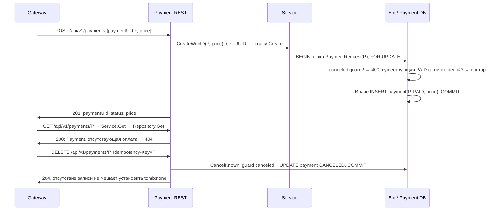

- Gateway заранее назначает P и проверяет совпадение UUID в ответе. Автоматического повтора POST Payment нет.
- DELETE с неправильным ключом → 400. DELETE без ключа вызывает Cancel: сначала проверяет существование, поэтому неизвестный P → 404.
- Это модель записи оплаты для лабораторной. Внешний платёжный провайдер в данном стеке не участвует. Payment не вызывает Reservation или Loyalty.

Стек вызовов:

```text
rest/payments.Register (Huma)
payments.Service.CreateWithID / Get / CancelKnown
postgres.Repository.Create / Get / CancelKnown
PaymentRequest + payment, одна транзакция
Gateway contracts.ClientWithResponses проверяет статус
```

Код: `services/payment/internal/rest/payments/register.go`, `services/payment/internal/postgres/repos/payments.go`, `services/gateway/internal/payment/repos/payments.go`.

## 19. Внутренние ручки Loyalty

Одна транзакция фиксирует ключ операции, счётчик, статус и скидку

| Метод / путь | Сценарий | Что фиксируется |
| --- | --- | --- |
| GET /loyalty | Service.Get → Repository.Get | ensure пользователя + SELECT; новый: 0 / BRONZE / 5 |
| POST /loyalty/reservations | Service.Change(delta=+1) | R:create: count+1, статус и скидка; 200 |
| DELETE /loyalty/reservations | Service.Change(delta=−1) | R:cancel или R:rollback; разные правила отката; 200 |
| POST /loyalty/reservations/{R}/resolve | Service.ResolveCreation | Зафиксировать исход создания, вернуть committed; 200 |

- Change: BEGIN → ensure → SELECT пользователя FOR UPDATE → прочитать связанный ключ → claim текущего ключа → LoyaltyChange.Decide → UPDATE → COMMIT.
- Повтор с тем же ключом и теми же user/delta возвращает текущее состояние без повторного изменения. Конфликт содержания ключа → 400. Запрос без ключа выполняется как legacy-изменение.
- R:rollback проверяет R:create: если увеличения не было, реальный delta=0; guard записывается. R:cancel уменьшает count на 1, но не ниже 0.
- Статус рассчитывается по новому счётчику: <10 BRONZE/5%; 10..19 SILVER/7%; ≥20 GOLD/10%. Правила находятся в entities, блокировки и фиксация — в Ent-репозитории.

Стек вызовов:

```text
rest/loyalties.Register
Service.Change → NewLoyaltyChange
Repository.Change: транзакция + FOR UPDATE
LoyaltyChange.Decide(current, applied, related)
COMMIT key + count + status + discount
```

Код: `services/loyalty/internal/rest/loyalties/register.go`, `services/loyalty/internal/models/entities/change.go`, `services/loyalty/internal/postgres/repos/loyalties.go`.

## 20. Circuit Breaker и fallback

У каждого downstream свой breaker; он охватывает законченные чтения

- Closed: пять последовательных ошибок доступности открывают breaker. Open: в течение 1s чтения сразу получают unavailable, без сетевого вызова. Half-open: допускается одна проба.
- Успешная проба закрывает breaker; новая ошибка доступности снова открывает. Исключены отмена клиентом и истечение его контекста; 400/404 не считаются ошибкой доступности.
- Успех определяется после чтения и разбора ответа, а не только получения HTTP-заголовков. Записи POST/DELETE, включая ResolveCreation, не проходят через breaker.
- Fallback — пустой JSON-блок, а не чтение старого значения из Redis. При неотменённом контексте он применяется только к availability-ошибкам.

Стек вызовов:

```text
Repository.Payment / Loyalty / Hotel / Reservation / Hotels
httpclient.Read → breaker.Allow
Вызов HTTP + проверка статуса + декодирование
done(success / availability failure / excluded)
Queries решает: fallback или ошибка
```

Код: `services/gateway/internal/httpclient/breaker.go`, `services/gateway/internal/models/entities/availability.go`, `services/gateway/internal/core/usecases/bookings/read.go`.

## 21. Статусы и ограничения

Как ошибка превращается в ответ Gateway; параметры взяты из YAML

| Условие | Ответ / правило | Где применяется |
| --- | --- | --- |
| Неверный ввод / отсутствующий объект | 400 / 404 | Валидация REST и usecase; ownership в Reservation |
| Reservation недоступен | 500: Reservation Service unavailable | Все критичные чтения и сценарии изменений |
| Loyalty недоступен | 503: Loyalty Service unavailable | Самостоятельное GET и создание бронирования |
| Payment недоступен при чтении | 200 с payment={} | GET reservations, GET reservations/R, GET me |
| Loyalty недоступен в /me | 200 с loyalty={} | Только если список удалось собрать |
| Redis недоступен / занят / полон | 503 | До побочных эффектов резервируется слот |
| Прочий downstream отказ / timeout | Обычно 502 / 504 | Если более приоритетная service-ошибка не определена |
| HTTP Gateway / downstream | 5s / 2s | 2s на одно обращение, общий запрос ограничен 5s |
| Параллелизм / in-flight | 4 строки; Reservation 16, Payment 8, Loyalty 8 | Ограничены worker обогащения и HTTP-клиенты |

- Mapper проверяет errors.Is в определённом порядке. Поэтому критичный Reservation timeout обычно становится 500, а Loyalty timeout — 503, а не универсальным 504.
- Пять секунд — общий request timeout, а не обещание, что последовательность из нескольких двухсекундных вызовов всегда уложится. Detached-компенсация отдельно ограничена 5s.
- При недоступности Payment и Loyalty здоровые нулевые поля не исчезают. Статус неизвестного блока определяет преобразование DTO, а не omitempty по цене или счётчику.

Стек вызовов:

```text
serviceError: panic → invalid → not found
→ Loyalty → Reservation → очередь
→ timeout → upstream unavailable
dto.paymentResponse / loyaltyResponse
YAML определяет лимиты и таймауты
```

Код: `services/gateway/internal/rest/bookings/errors.go`, `services/gateway/internal/rest/bookings/dto.go`, `services/gateway/config.yaml`.

## 22. Служебные ручки

Health, метрики и документация не запускают бронирование или Saga

| Ручка Gateway | Что происходит после запроса | Что получает клиент |
| --- | --- | --- |
| GET /manage/health | Chi handler выставляет статус; downstream не опрашиваются | 200, без тела |
| GET /metrics | telemetry.Handler собирает Prometheus collectors | Метрики HTTP, Go/process и операций; без user/UUID labels |
| GET /api/v1/docs | Huma публикует Swagger UI для сгенерированного API | HTML интерфейс документации |
| GET /api/v1/openapi.json | JSON схемы из api.GetSpec, сериализованной при запуске | OpenAPI-контракт Gateway |

- Текущие пути взяты из YAML. Документация и метрики могут быть переименованы конфигурацией. Здоровье Gateway не означает доступность Reservation, Payment или Loyalty.
- Каждый downstream также имеет GET /manage/health. Служебные endpoints downstream регистрируются общим infrastructure-кодом; конкретные docs/metrics пути задаются YAML сервиса.
- Docker entrypoints принимают --config PATH и --config=PATH в любом месте до --; Atlas и приложение используют один YAML. Store работает с UUID-ключами и Gob-конвертом без версий. Преобразования старых данных нет. При запуске собираются клиенты, три breaker, Actions, Processor, Redis Store, Stream, Commands и Queries. Worker стартует рядом с HTTP-сервером.
- При завершении HTTP-сервер прекращает приём и завершает запросы; затем останавливаются worker, вызывается Drain с лимитом 20s, закрываются Redis и остальные ресурсы.

Стек вызовов:

```text
cmd/gateway.Run
system.Register → api.GetSpec / Huma / telemetry
router.Get("/manage/health", …)
rest.Serve → server.Shutdown
stopStream → stream.Run finished → Drain
```

Код: `services/gateway/internal/rest/system/register.go`, `services/gateway/cmd/gateway/run.go`, `modules/platform/rest/server.go`.

## 23. Конкретный пример: Анна

Три ночи × 10 000 ₽; начальный счётчик 9; читаем, создаём и отменяем

- 1. GET /loyalty: count=9, BRONZE, discount=5. GET /hotels возвращает отель Ararat Park Hyatt Moscow с ценой 10 000.
- 2. POST с 2026-10-20 по 2026-10-23: nights=3; цена 30 000×95/100=28 500. Созданы Payment P и Reservation R со статусом PAID.
- 3. R:create увеличивает счётчик до 10: теперь SILVER/7%. Ответ этого создания всё ещё содержит discount=5 — именно эта скидка применена к оплате.
- 4. GET /me собирает R + Hotel + Payment(28 500), затем текущее Loyalty(10, SILVER, 7). Скидка в лояльности уже может отличаться от скидки прошлого бронирования.
- 5. DELETE R: P→CANCELED, затем R→CANCELED, затем R:cancel: count 10→9, BRONZE/5. Повтор DELETE даёт 204 без второго уменьшения.
- 6. Если Loyalty выключен только при отмене, DELETE даёт 204 после принятия остатка задачи. Счётчик изменится после восстановления сервиса и повтора worker.

Стек вызовов:

```text
POST /api/v1/reservations
X-User-Name: Анна
Content-Type: application/json
{"hotelUid":"049161bb-badd-4fa8-9d90-87c9a82b0668",
 "startDate":"2026-10-20", "endDate":"2026-10-23"}
Проверка результата: GET /api/v1/me
```

Код: `services/gateway/internal/core/usecases/bookings/create.go`, `services/loyalty/internal/models/entities/loyalty.go`, `services/gateway/internal/core/usecases/bookings/cancel.go`.

## 24. Куда смотреть в коде

Навигатор по реализации и границы описания

| Вопрос | Файл / каталог |
| --- | --- |
| Как собраны зависимости и жизненный цикл | services/gateway/cmd/gateway/run.go |
| HTTP → DTO → конкретный usecase | services/gateway/internal/rest/bookings/handlers.go |
| Чтение списка, одной брони, /me, отелей и Loyalty | services/gateway/internal/core/usecases/bookings/{read,list}.go |
| Создание и отмена | services/gateway/internal/core/usecases/bookings/{create,cancel}.go |
| Фоновый запуск и фиксация | services/gateway/internal/core/services/opstream/{stream,worker}.go |
| План, порядок и политика повторов | services/gateway/internal/core/usecases/operations |
| Типы payload / маршрутизация | services/gateway/internal/models/entities/operation_payload.go; internal/core/usecases/operations/actions.go |
| Выдача Streams, транзакции и fencing | services/gateway/internal/redis/repos/{streams,transaction,attempts}.go |
| Транзакции, guards и счётчик | services/{reservation,payment,loyalty}/internal/postgres/repos |
| Лимиты и контракты | services/gateway/config.yaml; internal/clients/contracts/openapi.yaml |

- Схемы отражают исходный код на дату сборки документа. Они описывают возможные вызовы и ветвления, а не фактическую трассу конкретного запущенного запроса.
- Гарантии: отдельные локальные транзакции, сохранённый план, идемпотентные действия и fencing фиксации очереди. Общей транзакции Redis + три БД и гарантии exactly-once доставки HTTP нет.
- Изменения файлов приложения этим документом не требуются. Пересборка PDF и Markdown: python3 scripts/render-gateway-guide.py (нужен ReportLab и шрифт DejaVu Sans).

Код: `docs/services.md`, `docs/sequences.md`, `scripts/render-gateway-guide.py`.
