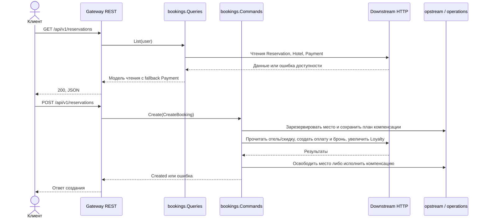
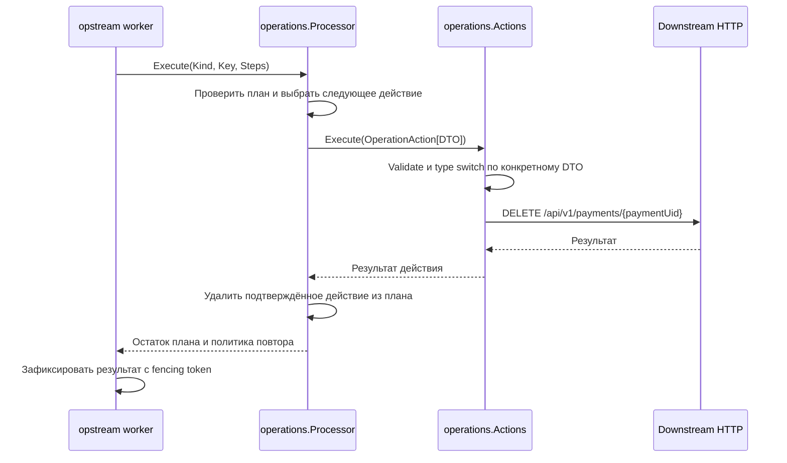

# Диаграммы последовательности

Сценарии текущей реализации Gateway. Между сервисами используется HTTP;
каждый сервис работает со своей логической БД через Ent. Redis хранит задачи
восстановления. Внутренние вызовы показаны без сгенерированных обёрток API.

В примерах `R` — UUID бронирования, `P` — UUID оплаты. Пользователь Анна имеет
скидку 5%. Три ночи по 10 000 ₽ стоят 28 500 ₽ со скидкой.

## 1. Успешное создание бронирования

Код: [Commands.Create](../services/gateway/internal/core/usecases/bookings/create.go).

```mermaid
sequenceDiagram
    actor C as Клиент
    participant G as Gateway / Commands.Create
    participant Q as Redis / opstream.Store
    participant R as Reservation
    participant P as Payment
    participant L as Loyalty
    C->>G: POST /api/v1/reservations; X-User-Name=Анна
    G->>G: Проверить входные данные; назначить R
    G->>Q: ReserveOperation(Kcreate, Compensation)
    Q-->>G: Место зарезервировано
    G->>R: GET /api/v1/hotels/{hotelUid}
    R-->>G: Отель, цена 10000
    G->>L: GET /api/v1/loyalty
    L-->>G: BRONZE, скидка 5%
    G->>G: Рассчитать стоимость 28500; назначить P
    G->>Q: Prepare(R, P, шаги компенсации)
    Q-->>G: План сохранён до первого POST
    G->>P: POST /api/v1/payments (paymentUid=P, price=28500)
    P->>P: Ent-транзакция: запись идемпотентности и оплата PAID
    P-->>G: 201, оплата P
    G->>R: POST /api/v1/reservations (reservationUid=R, paymentUid=P)
    R->>R: Ent-транзакция: запись идемпотентности и бронирование PAID
    R-->>G: 201, бронирование R
    G->>Q: Prepare(первый шаг ResolveCreation)
    Q-->>G: Необходимость уточнить исход сохранена
    G->>L: POST /api/v1/loyalty/reservations; Idempotency-Key=R:create
    L->>L: Ent-транзакция: счётчик +1 и ключ R:create
    L-->>G: 200, счётчик 1
    G->>Q: ReleaseOperation(Kcreate)
    Q-->>G: completed; место освобождено, payload очищен
    G-->>C: 200, бронирование и оплата на 28500
```

Скидка определяется до увеличения счётчика. При заполнении очереди или
недоступности Redis резервирование возвращает ошибку, Gateway отвечает 503
до побочных эффектов.

## 2. Потеря ответа Payment и компенсация

UUID оплаты уже сохранён в Redis. POST Payment автоматически не повторяется.
Код: [Processor.compensate](../services/gateway/internal/core/usecases/operations/compensate.go).

```mermaid
sequenceDiagram
    actor C as Клиент
    participant G as Gateway / Commands.Create
    participant S as opstream.Stream / Processor
    participant Q as Redis
    participant R as Reservation
    participant P as Payment
    participant L as Loyalty
    Note over G,Q: Место зарезервировано; план с R и P сохранён
    G->>P: POST /api/v1/payments (P, 28500)
    P->>P: COMMIT оплаты P со статусом PAID
    P--xG: Ответ потерян
    G->>S: Groups.finish: Execute(Compensation)
    Note over G,S: Откат независим от отмены HTTP-запроса; таймаут 5s
    S->>Q: Start(Kcreate)
    Q-->>S: Выдача с fencing token
    S->>R: DELETE /api/v1/reservations/R; Idempotency-Key=R
    R->>R: Запретить позднее создание R, даже если записи нет
    R-->>S: 204
    S->>P: DELETE /api/v1/payments/P; Idempotency-Key=P
    P->>P: Отменить P и запретить позднее создание P
    P-->>S: 204
    S->>L: DELETE /api/v1/loyalty/reservations; Idempotency-Key=R:rollback
    L->>L: R:create отсутствует; сохранить откат без уменьшения счётчика
    L-->>S: 200, счётчик 0
    S->>Q: Finish(completed)
    S-->>G: Результат компенсации
    G-->>C: Ошибка создания
```

Диаграмма показывает успешный откат. Ошибка одного шага не мешает попытке
остальных. Невыполненные шаги сохраняются в Redis для повтора через 10s.
Увеличение Loyalty здесь ещё не начиналось: шага `ResolveCreation` в плане нет.

## 3. Восстановление после аварии на последнем шаге

Перед увеличением Loyalty в начало плана добавляется `ResolveCreation`. Новый Gateway
получает задачу после истечения lease и уточняет исход в транзакции Loyalty.

```mermaid
sequenceDiagram
    participant G as Gateway до аварии
    participant Q as Redis
    participant L as Loyalty
    participant W as Worker нового Gateway
    participant R as Reservation
    participant P as Payment
    Note over G,P: Оплата P и бронирование R уже созданы
    G->>Q: Prepare(первый шаг ResolveCreation)
    Q-->>G: Сохранено
    G->>L: POST /api/v1/loyalty/reservations; Idempotency-Key=R:create
    Note over G,L: Gateway падает; неизвестно, был ли COMMIT Loyalty
    Note over Q,W: После истечения lease задача доступна новому владельцу
    W->>Q: ReadyKeys(compensation), Take(Kcreate)
    Q-->>W: Задача, новый lease и fencing token
    W->>L: POST /api/v1/loyalty/reservations/R/resolve
    L->>L: Ent-транзакция с блокировкой строки пользователя
    alt Запись R:create сохранена
        L-->>W: 200, committed=true
        W->>W: Очистить все шаги компенсации
        W->>Q: Finish(completed)
        Note over R,P: Бронирование и оплата сохраняются
    else Увеличение не сохранено
        L->>L: Сохранить R:rollback, запретив позднее увеличение
        L-->>W: 200, committed=false
        W->>R: DELETE /api/v1/reservations/R; Idempotency-Key=R
        R-->>W: 204
        W->>P: DELETE /api/v1/payments/P; Idempotency-Key=P
        P-->>W: 204
        W->>L: DELETE /api/v1/loyalty/reservations; Idempotency-Key=R:rollback
        L-->>W: 200, повтор не изменяет счётчик
        W->>Q: Finish(completed или оставшиеся шаги)
    else Loyalty недоступен
        L--xW: Ошибка доступности
        W->>Q: Finish(deferred, первый шаг ResolveCreation)
        Note over W,P: Отмена не начинается; решение повторяется через 10s
    end
```

Изменение счётчика и решение `resolve` сериализуются блокировкой одной строки
Loyalty. Потеря ответа `resolve` допускает безопасный повтор. Общей транзакции
сервисов и Redis нет: клиент после потери ответа может не знать исход запроса.

## 4. Отмена при недоступном Loyalty

Код: [Commands.Cancel](../services/gateway/internal/core/usecases/bookings/cancel.go)
и [Processor.cancel](../services/gateway/internal/core/usecases/operations/cancel.go).

```mermaid
sequenceDiagram
    actor C as Клиент
    participant G as Gateway / Commands.Cancel
    participant S as opstream.Stream / Processor
    participant Q as Redis
    participant P as Payment
    participant R as Reservation
    participant L as Loyalty
    participant W as Worker
    C->>G: DELETE /api/v1/reservations/R; X-User-Name=Анна
    G->>R: GET /api/v1/reservations/R с проверкой пользователя
    R-->>G: Бронирование PAID, paymentUid=P
    G->>Q: PendingOperation(Kcancel), ReserveOperation(Kcancel)
    Q-->>G: Место зарезервировано
    G->>S: Execute(Cancellation)
    S->>Q: Start(Kcancel)
    Q-->>S: Выдача с fencing token
    S->>P: DELETE /api/v1/payments/P; Idempotency-Key=P
    P-->>S: 204
    S->>R: DELETE /api/v1/reservations/R; Idempotency-Key=R
    R-->>S: 204
    S->>L: DELETE /api/v1/loyalty/reservations; Idempotency-Key=R:cancel
    L--xS: Loyalty недоступен
    S->>Q: Finish(deferred, Steps=[DecreaseLoyalty])
    Q-->>S: Задача сохранена
    S-->>G: Отмена выполнена; изменение Loyalty отложено
    G-->>C: 204
    Note over Q,W: Через 10s, в том числе после перезапуска Gateway
    W->>Q: ReadyKeys(loyalty), Take(Kcancel)
    Q-->>W: Оставшийся шаг
    W->>L: DELETE /api/v1/loyalty/reservations; Idempotency-Key=R:cancel
    L->>L: Ent-транзакция: счётчик -1 и ключ R:cancel
    L-->>W: 200, счётчик 0
    W->>Q: Finish(completed)
```

Если первая отмена Payment завершается ошибкой, Processor не отменяет
Reservation: бронирование остаётся PAID, клиент получает ошибку. Эта первая
неудачная отмена Payment не переводится в автоматический фоновый повтор.

## 5. Чтение с fallback Payment

Код: [Queries.Get и reservationWithHotel](../services/gateway/internal/core/usecases/bookings/read.go).

```mermaid
sequenceDiagram
    actor C as Клиент
    participant G as Gateway / Queries.Get
    participant R as Reservation
    participant B as Circuit Breaker Payment
    participant P as Payment
    C->>G: GET /api/v1/reservations/R; X-User-Name=Анна
    G->>R: GET /api/v1/reservations/R
    R-->>G: Бронирование пользователя, UUID отеля и оплаты
    G->>R: GET /api/v1/hotels/{hotelUid}
    R-->>G: Сведения об отеле
    G->>B: payments.Payment(P) через httpclient.Read
    alt Breaker разрешает чтение
        B-->>G: Вызов разрешён
        G->>P: GET /api/v1/payments/P
        alt Успешный ответ
            P-->>G: 200, статус и стоимость оплаты
            G->>B: Зафиксировать успех
            G-->>C: 200, бронирование с оплатой
        else Ошибка доступности
            P--xG: Ошибка доступности
            G->>B: Зафиксировать ошибку доступности
            G-->>C: 200, бронирование с payment={}
        end
    else Breaker открыт
        B-->>G: Сервис недоступен; HTTP-вызов не выполняется
        G-->>C: 200, бронирование с payment={}
    end
```

Пять последовательных ошибок доступности открывают breaker на 1s, затем
допускается одна проба. Breaker каждого downstream независим; изменяющие
запросы через него не проходят. Ошибки ввода, отсутствие записи и отмена
клиентского запроса не превращаются в fallback доступности.

Для `/me` также допускается `loyalty={}` при недоступности Loyalty.
Самостоятельный `/loyalty` и создание при недоступном чтении Loyalty возвращают
503. Недоступность критичного Reservation возвращает 500.

## Стек вызовов фонового выполнения

```text
opstream.Stream.Run
└─ worker.Run
   └─ worker.runLane
      └─ worker.runReady
         ├─ Store.ReadyKeys
         └─ worker.execute
            ├─ Store.Take
            └─ worker.process
               ├─ worker.invoke
               │  └─ operations.Processor.Execute
               │     ├─ compensate: уточнение исхода и компенсация
               │     └─ cancel: Payment → Reservation → Loyalty
               └─ Store.Finish: результат и оставшиеся шаги
```

Первая синхронная попытка проходит через `Stream.Execute → Store.Start →
worker.process`. Фоновые попытки используют тот же Processor. Lease ограничивает
время владения задачей; fencing token запрещает сохранять результат устаревшей
выдачи. Идемпотентность downstream защищает повторное исполнение бизнес-шагов.

## 6. Разделение команд и запросов



Queries имеет только интерфейсы Reader; Commands получает отдельные порты
для сценариев изменения. Обработчики не зависят друг от друга.

## 7. Типизированные операции и usecase



UUID оплаты находится в CancelPaymentOperation, а не в общей записи очереди.
План и DTO сохраняются в Redis до побочных эффектов и переживают перезапуск.

## Полный разбор ручек

[Иллюстрированный PDF на 23 страницы](gateway-request-flow.pdf): все внешние
ручки Gateway, внутренние вызовы сервисов, локальные транзакции, Circuit Breaker,
компенсации, очередь и восстановление. [Текстовая версия](gateway-request-flow.md).

`Kcreate` и `Kcancel` — разные детерминированные UUID задач для одного R,
полученные `OperationKey(Kind, R)`. Внутри Gateway payload — конкретные DTO;
Gob-кодирование выполняет только Redis-адаптер. Старые JSON-payload
не поддерживаются.
